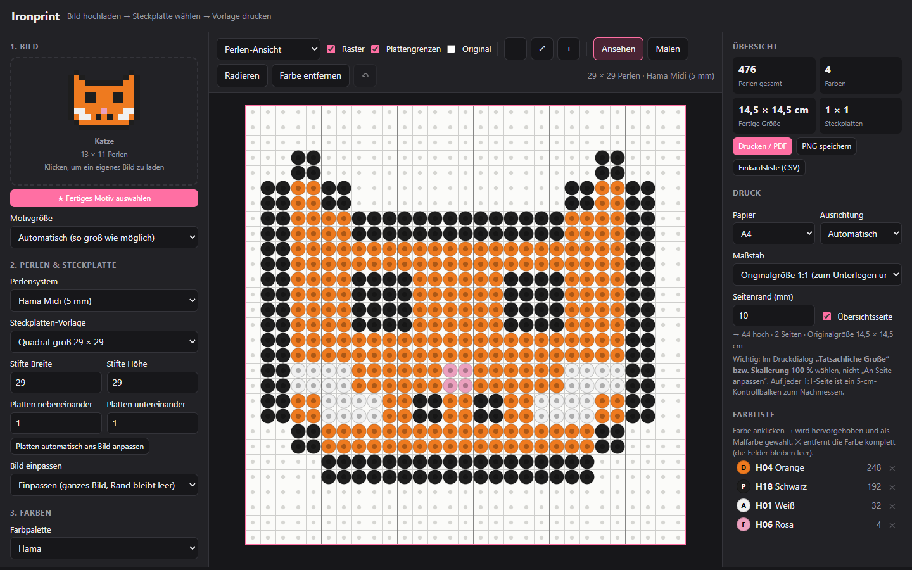
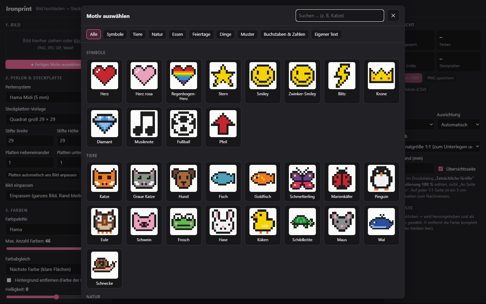
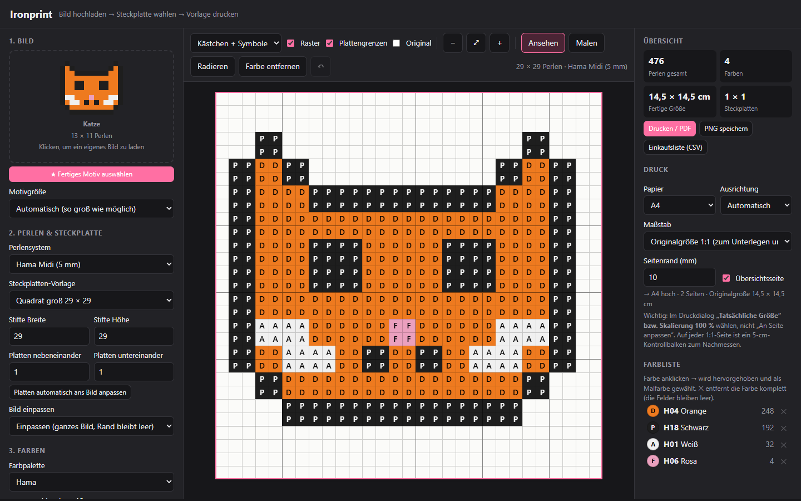
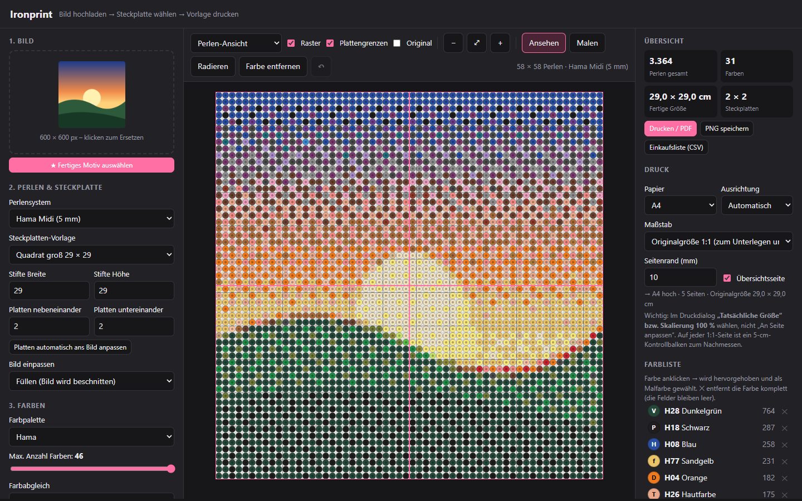

# Ironprint

**Bügelperlen-Vorlagen aus eigenen Bildern – direkt im Browser.**

Ironprint wandelt ein Foto, eine Zeichnung oder ein fertiges Pixel-Motiv in eine druckbare Steckvorlage für Bügelperlen (Hama, Perler, Artkal, IKEA Pyssla, Nabbi …) um. Die Vorlage lässt sich in Originalgröße 1:1 ausdrucken und direkt unter die Steckplatte legen.

👉 **Online ausprobieren:** https://scazadar.github.io/ironprint/

Keine Installation, kein Konto, kein Upload: Ironprint ist eine einzelne HTML-Datei, alle Bilder werden lokal im Browser verarbeitet.



---

## Funktionen

- **Eigenes Bild oder fertiges Motiv** – Bild per Drag & Drop laden (PNG, JPG, GIF, WebP) oder aus über 100 eingebauten Pixel-Motiven, Mustern, Buchstaben und Zahlen wählen. Eigene Schriftzüge lassen sich ebenfalls erzeugen.
- **Alle gängigen Perlensysteme** – Hama Midi/Mini/Maxi, Perler (Mini), Artkal S/C/R, IKEA Pyssla, Nabbi oder ein eigenes Rastermaß.
- **Steckplatten** – quadratisch, rechteckig oder rund in den üblichen Größen sowie eigene Maße. Mehrere Platten können neben- und untereinander kombiniert werden, auch automatisch passend zum Seitenverhältnis des Bildes.
- **Echte Perlenfarben** – Paletten für Hama, Perler und 16 Grundfarben. Einzelne Farben lassen sich abwählen, wenn sie nicht vorrätig sind, und die Anzahl der Farben kann begrenzt werden.
- **Bildanpassung** – Helligkeit, Kontrast, Sättigung, Hintergrund entfernen und Dithering (Floyd-Steinberg) für Fotos.
- **Nachbearbeiten** – einzelne Perlen malen oder radieren, eine Farbe überall entfernen, Rückgängig mit Strg+Z.
- **Vier Ansichten** – Perlen, Kästchen, Kästchen mit Symbolen und eine „gebügelte“ Vorschau.
- **Export** – Druck bzw. PDF (1:1 oder seitenfüllend, A5 bis A3 und US-Formate, mit Übersichtsseite), PNG-Bild sowie eine Einkaufsliste als CSV mit der Perlenanzahl pro Farbe.

## Screenshots

### Fertiges Motiv auswählen
Über 100 Motive in den Kategorien Symbole, Tiere, Natur, Essen, Feiertage, Dinge, Muster sowie Buchstaben & Zahlen, mit Suchfunktion und Generator für eigenen Text.



### Vorlage mit Symbolen
Jede Farbe bekommt ein eigenes Symbol, damit die Vorlage auch im Schwarz-Weiß-Druck lesbar bleibt. Die Farbliste rechts zeigt Artikelnummer, Farbname und benötigte Stückzahl.



### Foto über mehrere Platten
Ein Bild auf 2 × 2 großen Platten (58 × 58 Perlen) mit Dithering für weiche Farbverläufe. Die Plattengrenzen sind rosa markiert.



## So geht's

1. **Bild wählen** – links ein eigenes Bild laden oder auf **★ Fertiges Motiv auswählen** klicken.
2. **Perlen & Steckplatte einstellen** – Perlensystem, Plattengröße und Anzahl der Platten wählen. Mit **Bild einpassen** festlegen, ob das Bild eingepasst, beschnitten oder gestreckt wird.
3. **Farben anpassen** – Palette wählen, Farbanzahl begrenzen und bei Fotos *Dithering* aktivieren. Unter **Verfügbare Perlenfarben** lassen sich Farben abwählen, die du nicht hast.
4. **Feinschliff** – in der Werkzeugleiste mit **Malen**, **Radieren** oder **Farbe entfernen** einzelne Perlen korrigieren.
5. **Drucken** – rechts auf **Drucken / PDF** klicken.

> **Wichtig beim Drucken:** Damit die Vorlage genau unter die Steckplatte passt, im Druckdialog **„Tatsächliche Größe“ bzw. Skalierung 100 %** wählen, nicht „An Seite anpassen“. Auf jeder 1:1-Seite ist ein 5-cm-Kontrollbalken zum Nachmessen.

## Lokal verwenden

Repository klonen oder nur die Datei [`index.html`](index.html) herunterladen und im Browser öffnen. Es wird kein Server und keine Internetverbindung benötigt.

```bash
git clone https://github.com/scazadar/ironprint.git
cd ironprint
start index.html     # Windows  (macOS: open index.html, Linux: xdg-open index.html)
```

## Hinweise

- Die Farbwerte der Paletten sind Annäherungen an die echten Perlenfarben. Bildschirm und Drucker können leicht abweichen.
- Hama, Perler, Artkal, IKEA Pyssla und Nabbi sind Marken ihrer jeweiligen Inhaber. Ironprint ist ein unabhängiges Projekt und steht in keiner Verbindung zu diesen Herstellern.

## Lizenz

Veröffentlicht unter der [MIT-Lizenz](LICENSE).
